<div align="center">

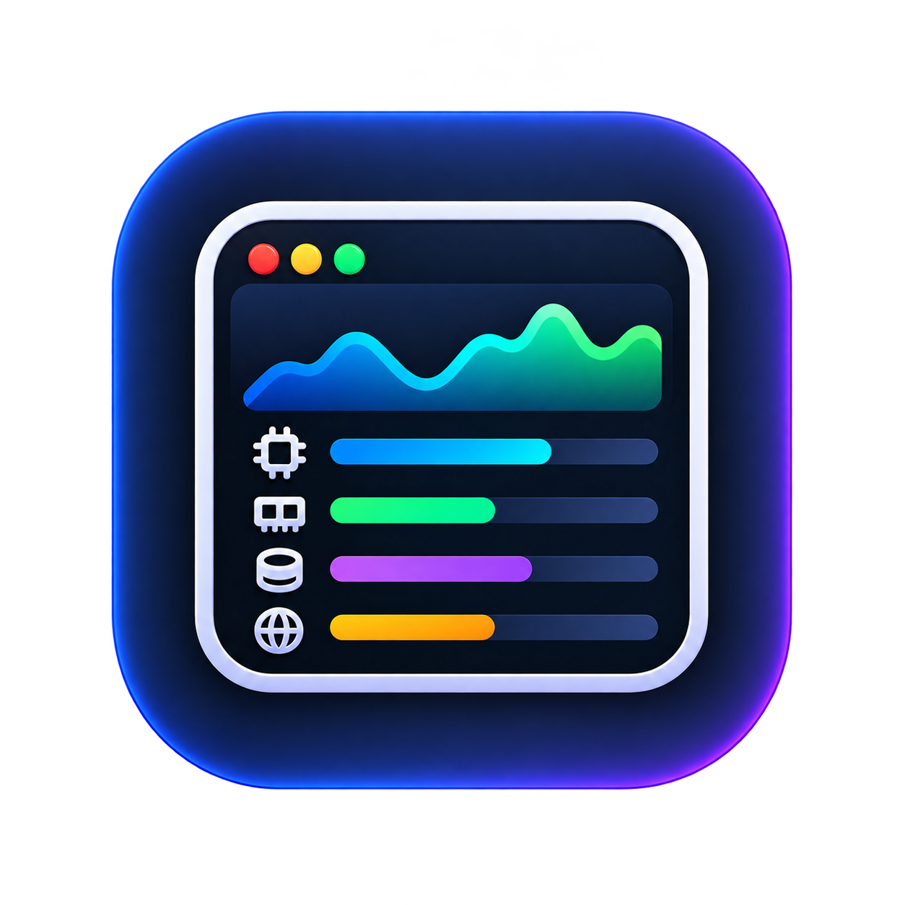

# Task Manager for macOS
### The Native Hardware & Software Performance Monitor for macOS

[](https://developer.apple.com/macos/)
[](releases/TaskManager-1.3.0-Universal.dmg)
[](https://swift.org)
[-purple?style=for-the-badge)](https://developer.apple.com/documentation/apple-silicon)
[](https://developer.apple.com/metal/)
[-success?style=for-the-badge)](#-privacy--offline-guarantee)
[](#-privacy--offline-guarantee)
[](LICENSE)

<p align="center">
  <strong>A high-performance, featherlight, Windows Task Manager inspired software and hardware monitor for macOS. An always-on menu bar monitor, a fully responsive window that adapts from a full-screen command center down to a compact 460-pt panel, live multi-engine GPU metrics, Mach CPU loads, memory pressure graphs, dedicated hardware deep-dive tabs, per-process telemetry with instant "End Task", live menu bar status, and startup app control.</strong>
</p>

[Download DMG](#-download--installation) •
[Overview](#-overview) •
[Screenshots](#-application-screenshots) •
[Key Features](#-key-features) •
[GPU Monitoring](#6--gpu-visualization--telemetry-apple-metal--iokit) •
[Installation & Build](#-download--installation) •
[Keyboard Shortcuts](#-keyboard-shortcuts) •
[Contributing](#-contributing)

</div>

---

## 📖 Overview

**Task Manager for macOS** brings the familiarity, precision, and power of the **Windows Task Manager** to the Mac ecosystem. It provides real-time, empirical hardware telemetry and granular software inspection without electron bloat, root daemons, or cloud analytics.

### Why Task Manager for macOS?
- **Zero Web Runtimes:** 100% native Swift, SwiftUI, AppKit, Metal, and Darwin Mach kernel APIs. No Electron, Node.js, Chromium, or web servers.
- **Featherlight Overhead:** Idles with `< 0.4%` CPU usage and `~25MB` memory footprint.
- **Always-On Menu Bar Utility:** Closing the window never quits the app. Task Manager keeps monitoring from the menu bar (and drops its Dock icon) until you explicitly choose **Quit** (<kbd>⌘</kbd> + <kbd>Q</kbd>). It registers as a login item on first launch so it is there after every restart.
- **Fully Responsive Window:** Every screen adapts as the window shrinks: the sidebar auto-collapses, cards reflow from multi-column grids into a single column, tables hide lower-priority columns, and headers wrap. Nothing clips or overlaps from a full-screen window down to ~460 pt wide.
- **Command-Center Dashboard:** On large windows all 5 core performance graphs (CPU, GPU, Memory, Disk, Network) fill one viewport with zero scrolling; on smaller windows they become a scrollable card grid.
- **Dedicated Hardware Diagnostic Tabs:** Clicking any component in the sidebar opens an in-depth diagnostic tab exclusively detailing that component's microarchitecture, pipelines, and top processes.
- **Live Sidebar Sparklines:** Real-time mini-graphs rendered directly in the sidebar navigation in strict order: **CPU $\rightarrow$ GPU $\rightarrow$ Memory $\rightarrow$ Disk $\rightarrow$ Network**.
- **Rotating Menu Bar Ticker + Speed Test:** The menu bar item cycles CPU, GPU, Memory, Storage and Network every 2 seconds (icon + value), and its popup includes a one-click internet speed test.
- **True GPU Visualization:** Real-time GPU load percentage, renderer utilization, tiler utilization, and allocated/in-use VRAM directly from Apple Silicon & discrete GPUs.
- **Memory-First Process Sorting:** Processes default-sorted by physical resident memory footprint for instant leak detection, with instant "End Task" process control.
- **100% In-Memory Ephemeral Telemetry:** Zero disk I/O writes for metrics; live 60-second rolling ring buffers prevent SSD wear. No SQLite metric rollups $>60$ seconds.
- **Research-Ready Figures:** Switch to the minimal **Publication** theme and press **Capture** to save all five live telemetry charts as separate paper-ready PNG figures from the same moment.
- **Refreshed Design (v1.1):** Gradient icon badges, layered cards, smooth monotone charts with consistent per-component colors, and a redesigned menu bar popover with sparklines and top processes.

---

## 📸 Application Screenshots

### 1. Performance Dashboard
<p align="center">
  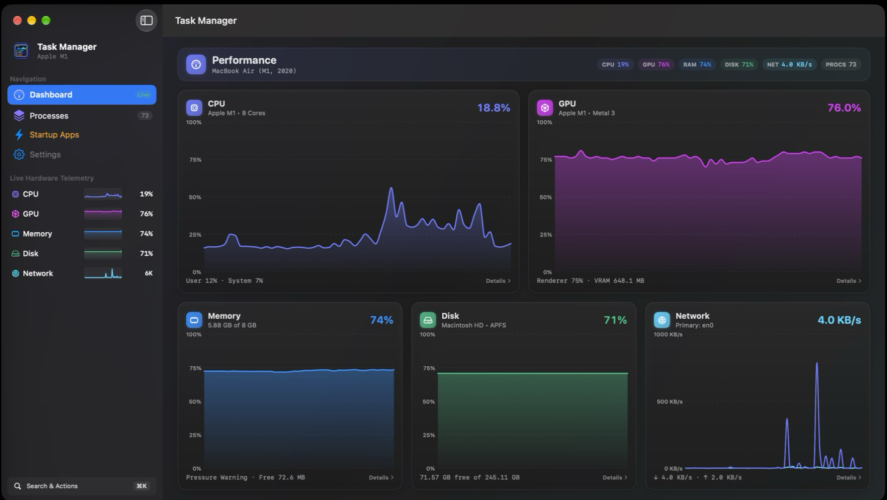
</p>

*The Performance Dashboard is a command center with 60-second live charts for CPU, GPU, Memory, Disk and Network, a live stat ticker, and sidebar sparklines. Click any card to open that component's detail page.*

---

### 1b. Publication Theme (Paper-Ready)
<p align="center">
  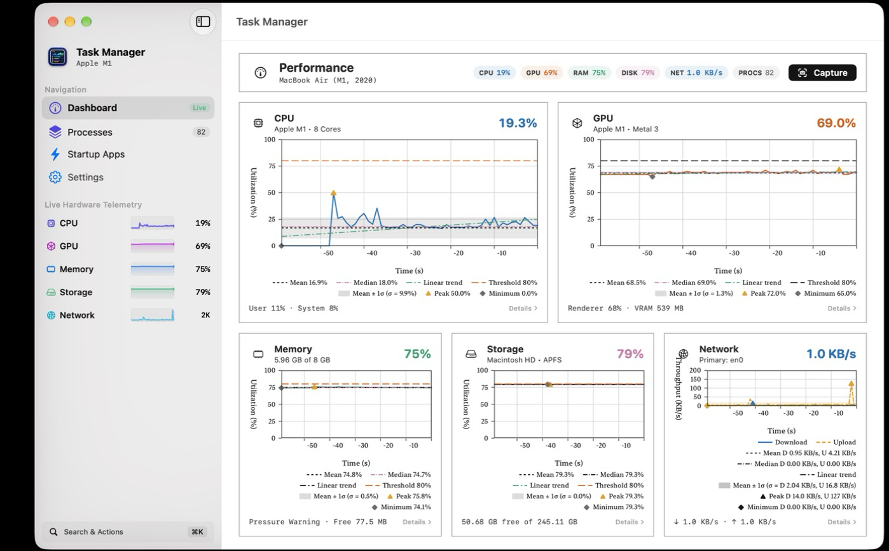
</p>

*The Publication theme strips the UI down to what a figure needs: white panels with thin rules, serif type, colour-blind-safe series colours, labelled time and unit axes, a dotted mean line, and a ▲ peak marker.*

#### Captured figures
Press **Capture** on the dashboard and five separate figures (CPU, GPU, Memory, Storage, Network) are saved to a new folder on your Desktop, all from the same instant and in the current theme:

<p align="center">
  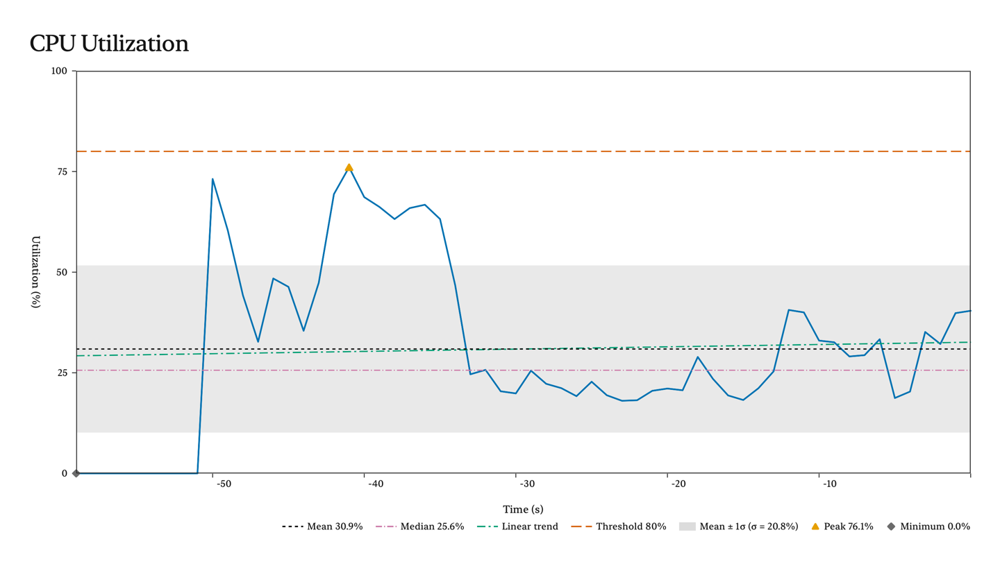
  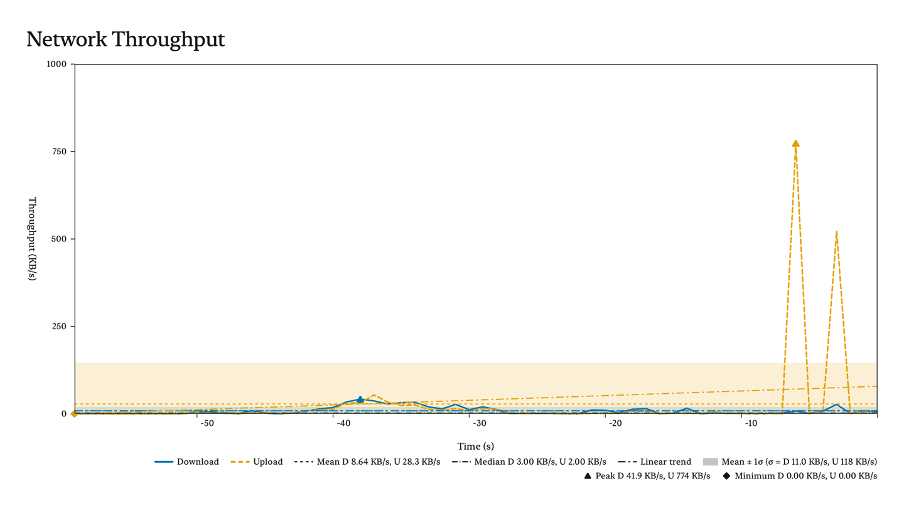
</p>
<p align="center">
  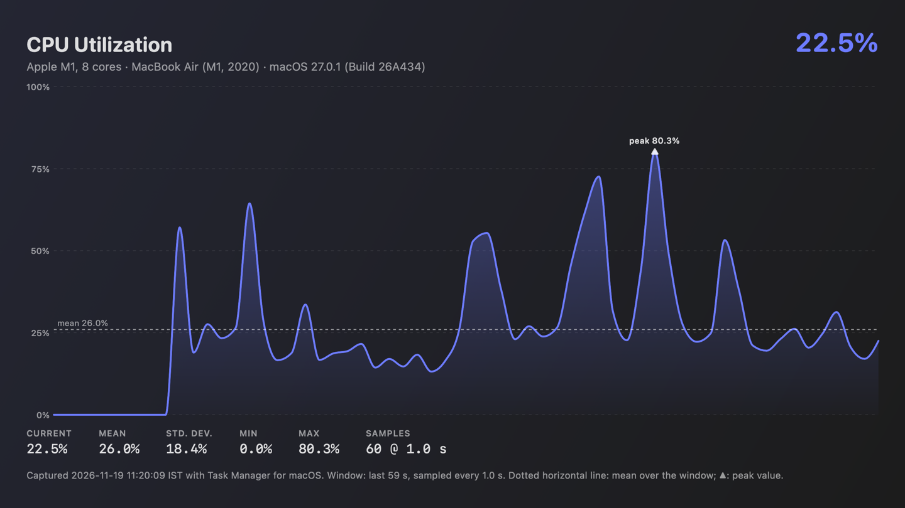
</p>

*Each figure has a title, device and macOS details, the 60-second chart, summary statistics (current, mean, standard deviation, min, max, sample count and interval) and a caption with the capture timestamp. Top: Publication theme. Bottom: Standard theme.*

---

### 2. Always-On Menu Bar Monitor & Speed Test
<p align="center">
  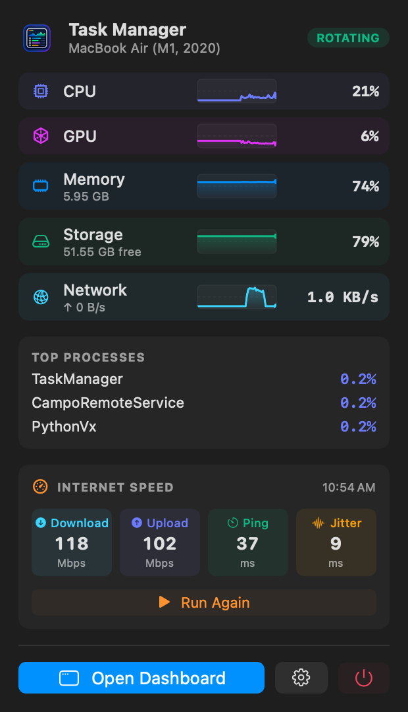
</p>

*The menu bar item rotates through CPU, GPU, Memory, Storage and Network every 2 seconds, showing just the component icon and its live value (or pins one metric if you turn rotation off). Its popup shows sparklines for every component, battery status, the top processes, a one-click **internet speed test** (download, upload, ping, jitter), and quick access to the dashboard, Settings, or Quit. It keeps running after the window is closed.*

---

### 3. Responsive Layout (Narrow Window)
<p align="center">
  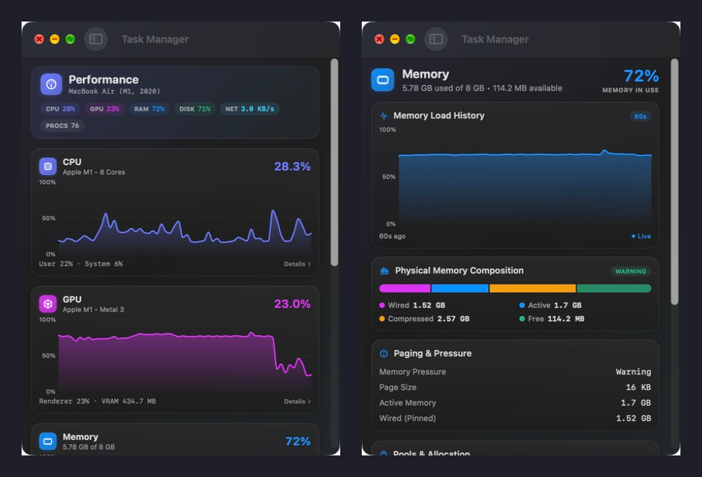
</p>

*Shrink the window and everything adapts: the sidebar collapses, the dashboard turns into a scrollable single-column card stack, stat pills wrap, and detail pages reflow their grids and tables.*

---

### 4. CPU Diagnostics
<p align="center">
  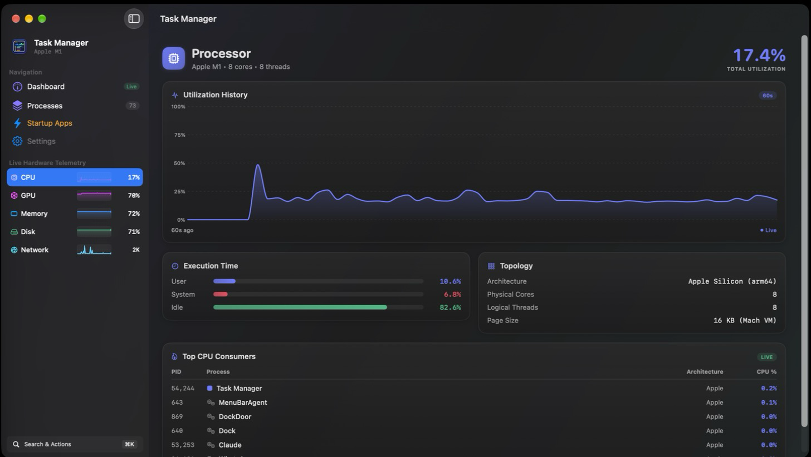
</p>

*Each component has its own detail page, with a 60-second history, utilization breakdown bars, topology specs, and the top consuming processes.*

---

### 5. Memory Diagnostics
<p align="center">
  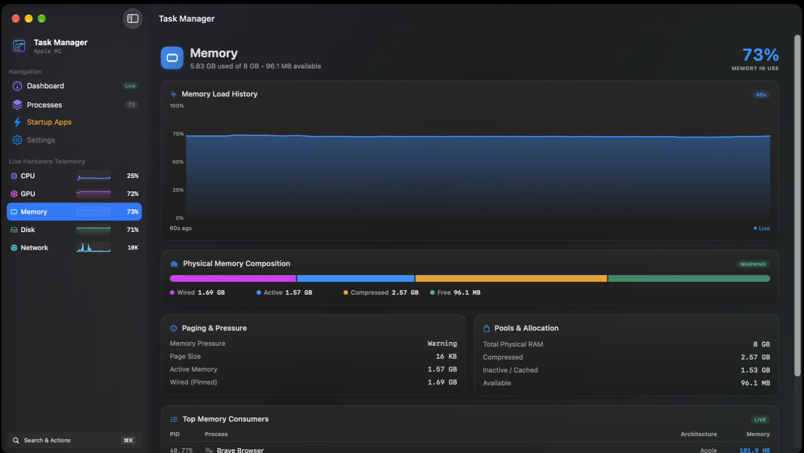
</p>

*The Memory page shows the load history, a color-coded composition bar (wired, active, compressed, free), memory pressure, and the heaviest processes.*

---

### 6. Processes ("End Task")
<p align="center">
  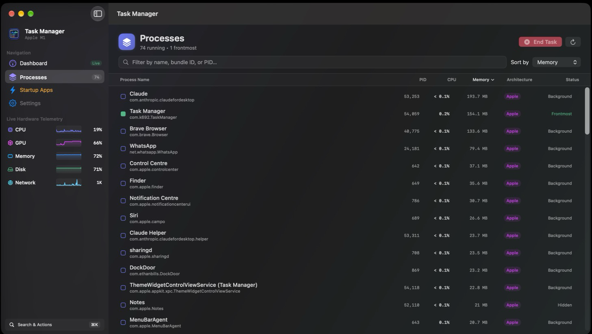
</p>

*A live inventory of every running process, sorted by memory by default. Click a column header to sort, filter by name, bundle ID or PID, and end or force-kill tasks. On narrow windows the PID, Architecture and Status columns hide automatically.*

---

### 7. Settings
<p align="center">
  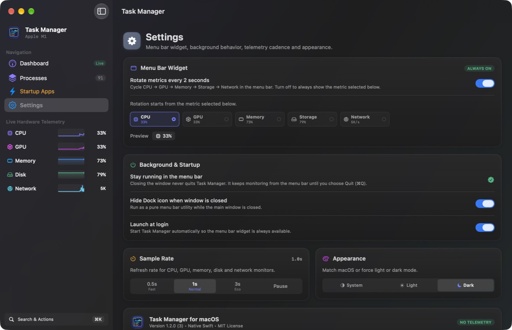
</p>

*Pick the menu bar metric, control Dock-icon hiding and launch at login, set the sampling rate and appearance, and view hardware specs.*

---

## ⚡ Key Features

### 1. ⚡ Responsive Performance Dashboard (Landing Page)
- **Adaptive Command Center:** On windows ≥ 820×560 pt it shows real-time 60-second charts for all 5 hardware components in a 2-row grid that fills the window with no scrolling. Smaller windows switch to a scrollable adaptive card grid (2 columns, then 1):
  - **Row 1:** CPU Card (50% width) and GPU Card (50% width, immediately succeeding CPU).
  - **Row 2:** Memory Card (33% width), Disk Card (33% width), and Network Card (33% width).
- **Live Stat Ticker:** CPU, GPU, RAM, disk, network and process-count pills that wrap onto extra lines on narrow windows.
- **Direct Component Navigation:** Clicking any dashboard card or "Details →" button navigates straight to that component's dedicated in-depth view.

### 2. 🔍 Dedicated Hardware Diagnostic Tabs
Under `Live Hardware Telemetry` in the sidebar, selecting any component opens an isolated deep-dive inspection tab:
- **CPU:** 60s utilization chart, user/kernel/idle time split, core topology, clock speed, cache specs, and top CPU consuming processes.
- **GPU (Immediately after CPU):** 60s GPU utilization chart, renderer core %, tiler deferred rendering %, in-use VRAM, allocated VRAM, Metal 3 feature set, hardware ray tracing support, and mesh shading capabilities.
- **Memory:** 60s memory load chart, stacked color-coded Mach VM composition bar (Wired, Active, Compressed, Free), memory pressure status gauge, Mach page size, and top memory-consuming processes.
- **Disk:** 60s volume space history chart, all mounted APFS/external volume cards with capacity gauges, mount paths, and filesystem attributes.
- **Network:** 60s dual-line throughput chart (Download ↓ Cyan, Upload ↑ Indigo), primary interface status, and detailed interface adapter table with live transfer rates and session traffic.

### 3. 📊 Live Sidebar Sparklines (Real-Time Mini Graphs)
- Hardware-accelerated mini sparkline graphs stream live in the leftmost navigation sidebar in strict order:
  1. **CPU** — Live utilization % + Real-time sparkline graph
  2. **GPU** — Live GPU load % + Real-time sparkline graph (immediately after CPU!)
  3. **Memory** — Live RAM usage % + Real-time sparkline graph
  4. **Disk** — Live primary disk usage % + Real-time sparkline graph
  5. **Network** — Live throughput rate + Real-time sparkline graph
- The sidebar collapses automatically below ~680 pt of window width and comes back when the window grows (or toggle it manually).
- Uses right-aligned fixed-time coordinate mapping with center reference lines and active indicator dots.

### 4. 🍎 Always-On Menu Bar Utility
- **Never Quits on Close:** Closing the main window leaves Task Manager running in the menu bar. The Dock icon hides automatically while the window is closed (toggle in Settings) and returns when you reopen it from the menu bar, Spotlight, or Finder. Only **Quit** (<kbd>⌘</kbd> + <kbd>Q</kbd>, or the power button in the popover) exits the app.
- **Starts with your Mac:** Launch at login is enabled on first run so the widget is always available after a restart. You can turn it off in Settings.
- **Rotating Status Bar Label:** Every 2 seconds the menu bar item cycles **CPU → GPU → Memory → Storage → Network**, showing only the component's icon and its live value (no text labels) centred in a fixed-width slot, so neighbouring menu bar icons never shift. Switch rotation off in Settings to pin one metric; picking a metric while rotation is on makes the cycle start there.
- **Internet Speed Test:** Press **Run Speed Test** in the popup to measure download and upload (4 parallel streams, ~7 s and ~6 s), ping and jitter. A live Mbps gauge shows progress, and results stay in the popup until you run it again. It uses Cloudflare's public speed test servers (speed.cloudflare.com) and only runs when you press the button.
- **Popup Hardware Monitor:** Clicking the menu bar item opens a compact HUD with live sparklines for CPU, GPU, Memory, Disk and Network, battery status and the top 3 processes. Click any row to jump to its detail page.
- **Common Mode RunLoop:** Scheduling on `RunLoop.main` in `.common` mode guarantees uninterrupted 1-second updates during user mouse tracking and scrolling.

### 5. 🚀 Software & Process Management ("Processes" Tab)
- Real-time inventory of all running applications and processes with inspectable memory, PID, and architecture (`Apple Silicon` / `Intel 64-bit`).
- **Memory-First Default Sort:** Automatically sorted by resident memory footprint descending to immediately surface memory-heavy applications.
- Live CPU % utilization per process calculated across Mach thread runtime differentials.
- Instant **"End Task"** action button and context menu with graceful (`NSRunningApplication.terminate`) and forced (`SIGKILL`) termination options.
- Instant search filter by application name, bundle identifier, or process PID.

### 5b. 📄 Publication Theme & Figure Capture (for researchers)
- **Two themes** in **Settings → Theme**:
  - **Standard:** the colourful app look (follows System / Light / Dark).
  - **Publication:** minimal and paper-ready, always on a white background, with serif typography, Okabe–Ito colour-blind-safe colours, solid/dashed line styles that survive greyscale printing, labelled *Time (s)* and unit axes with ticks, a plot frame, a **dotted mean line** and a **▲ peak marker** on every chart.
- **Capture button** on the Performance Dashboard:
  - Saves **five separate PNG figures** (`1-CPU.png`, `2-GPU.png`, `3-Memory.png`, `4-Storage.png`, `5-Network.png`) to `~/Desktop/Task Manager Capture <date> at <time> (<theme>)/`.
  - All five are rendered from **one snapshot taken at the same instant**, so the figures are directly comparable.
  - They use the **current theme**, at 2880×1620 px (3× of 960×540 pt).
  - Each figure includes the title, device and macOS version, the chart, statistics (current, mean, std. dev., min, max, samples @ interval) and a caption with the timestamp and an explanation of the markings.
  - Network figures auto-scale to KB/s or MB/s and include a line-style legend (solid = download, dashed = upload).
- The first capture may trigger macOS's one-time **"access files in your Desktop folder"** prompt. Allow it so figures can be saved.

### 6. 🎮 GPU Visualization & Telemetry (Apple Metal + IOKit)
- **Live 60-Second Utilization Graph:** Continuous GPU engine load time-series rendered via Swift Charts.
- **Multi-Engine Breakdown:** Overall Device Utilization %, Renderer Core Utilization %, and Tiler Pipeline Utilization %.
- **VRAM / Unified Memory Tracking:** Real-time allocated system memory and active in-use VRAM.
- **Metal Hardware Profile:** Dynamic device identification via Apple Metal (`MTLCopyAllDevices`).

### 7. ⚙️ Settings & Single-Selection Menu Bar Widget
- **Responsive Layout:** Cards sit side by side on wide windows and stack on narrow ones; the page scrolls only when it has to.
- **Menu Bar Rotation Toggle:** Turn the 2-second CPU → GPU → Memory → Storage → Network rotation on or off.
- **Single-Selection Menu Bar Widget:** Select which hardware component (**CPU**, **GPU**, **Memory**, **Disk**, or **Network**) is visible on the macOS top status bar using single-selection radio chips, as only one icon and live telemetry metric can be displayed cleanly at a time.
- **Live Menu Bar Preview:** Immediate preview of the active menu bar status item.
- **Background & Startup:** Hide the Dock icon while the window is closed, and toggle launch at login.
- **Telemetry & Sample Rate Control:** Custom segmented cadence pills (`0.5s Fast`, `1.0s Normal`, `3.0s Eco`, `Pause`) with active interval badge and explicit volatile in-memory ring buffer architecture (zero disk writes).
- **Theme:** Standard or Publication (paper-ready). See the Publication Theme & Figure Capture section above.
- **Appearance:** System, Light, and Dark mode selectors (Standard theme; Publication always uses white).
- **Hardware Specs:** Device model, architecture, processor, installed RAM, graphics and macOS version in an adaptive grid.
- **Desktop Widget Blueprint:** See [`Documentation/DesktopWidgetGuide.md`](Documentation/DesktopWidgetGuide.md) for full architectural patterns and Swift source code to add native macOS Sonoma/Sequoia Desktop Widgets.

---

## 🛠 Download & Installation

### Option 1: Download Pre-Built Universal DMG (Recommended)

You can download the ready-to-run Universal macOS installer directly from the repository:

👉 **[Download TaskManager-1.3.0-Universal.dmg (v1.3.0)](https://github.com/K-692/Task-Manager4MacOS/raw/main/releases/TaskManager-1.3.0-Universal.dmg)**

#### What's new in v1.3.0
- **Publication theme:** a second visual theme (**Settings → Theme**) for researchers: white background, serif type, colour-blind-safe (Okabe–Ito) lines, labelled *Time (s)* and unit axes, a dotted mean line and a ▲ peak marker on every chart, ready to paste into a paper.
- **One-click Capture:** a **Capture** button on the dashboard saves CPU, GPU, Memory, Storage and Network as **five separate high-resolution PNG figures** (2880×1620) from the **same instant**, in the current theme, into a new folder on your Desktop.

#### What's new in v1.2.2
- **Centered menu bar item:** the icon and value are now centred in a tightly sized fixed-width slot, so the spacing is even on both sides and the item still never changes size or pushes other menu bar icons.

#### What's new in v1.2.1
- **Fixed-width menu bar item:** the rotating metric now sits in a fixed-width slot, so other menu bar icons no longer shift as it cycles between CPU, GPU, Memory, Storage and Network.

#### What's new in v1.2.0
- **Rotating menu bar metric:** the menu bar icon and value cycle CPU → GPU → Memory → Storage → Network every 2 seconds (icon + value only, no text label). Turn it off in **Settings → Menu Bar Widget** to pin a single metric.
- **Internet speed test in the menu bar:** open the menu bar popup and press **Run Speed Test** to measure download, upload, ping and jitter, with results shown right in the popup.

#### What's new in v1.1.0
- Fully responsive window: sidebar auto-collapse, adaptive card grids, wrapping headers, and tables that hide columns on narrow widths. The minimum window size is now ~460×420 pt (was 960×640).
- Always-on menu bar mode: closing the window never quits; the Dock icon hides while the window is closed; launch at login is enabled on first run.
- Redesigned menu bar popover with sparklines, top processes, and quick actions.
- Refreshed UI: icon badges, layered cards, smoother charts with consistent component colors, sortable process columns.
- Fixed a duplicate **View** menu; navigation shortcuts now live in the **Go** menu.

#### Release Verification & Specifications

| Property | Details |
|:---|:---|
| **Package** | [`releases/TaskManager-1.3.0-Universal.dmg`](releases/TaskManager-1.3.0-Universal.dmg) |
| **Version** | `1.3.0` |
| **Target Architecture** | **Universal Binary** (`arm64` Apple Silicon M1/M2/M3/M4 + `x86_64` Intel 64-bit) |
| **Minimum OS** | macOS 13.0 (Ventura), macOS 14.0 (Sonoma), macOS 15.0 (Sequoia) |
| **Package Size** | ~6.0 MB (Compressed Read-Only UDZO) |
| **SHA-256 Checksum** | `9400e61615027ad64878c5f0182a634de0365437ee4fce8ce49d885e7804603a` |

#### Installation Steps:
1. Download **[TaskManager-1.3.0-Universal.dmg](releases/TaskManager-1.3.0-Universal.dmg)**.
2. Double-click the `.dmg` file to mount it.
3. Drag **Task Manager** into your **Applications** folder shortcut.
4. Eject the disk image and launch **Task Manager** from Launchpad, Spotlight (<kbd>⌘</kbd> + <kbd>Space</kbd>), or Applications.
5. The live metric appears in your menu bar. Closing the window keeps it running there; use **Quit** (<kbd>⌘</kbd> + <kbd>Q</kbd>) to exit.

> [!TIP]
> **macOS Gatekeeper Notice:** Since this open-source build is ad-hoc signed for independent distribution without an Apple Developer ID certificate, macOS may prompt an alert on the first launch. Simply right-click **Task Manager.app** in `/Applications` and choose **Open**, or run the following command in Terminal:
> ```bash
> xattr -cr "/Applications/Task Manager.app"
> ```

---

### Option 2: Build & Package Universal DMG from Source

To compile both `arm64` and `x86_64` architecture slices, generate the universal fat binary, assemble the `.app` bundle, and package a compressed `.dmg`:

```bash
# Clone the repository
git clone https://github.com/K-692/Task-Manager4MacOS.git
cd Task-Manager4MacOS

# Build Universal app and package DMG
./Scripts/package-dmg.sh
```
The output disk image will be created at `dist/TaskManager-1.3.0-Universal.dmg` and updated in `releases/`.

---

### Option 3: Compile Local App Bundle

To assemble a native `.app` bundle directly on your Mac:

```bash
# For Universal (Apple Silicon + Intel) bundle:
./Scripts/build-universal.sh

# For native host architecture bundle:
./Scripts/build-app.sh

# Open Task Manager
open "dist/Task Manager.app"
```

---

### Option 4: Run via Swift Package Manager

```bash
swift run TaskManager
```

---

## ⌨️ Keyboard Shortcuts

| Shortcut | Action |
|:---|:---|
| <kbd>⌘</kbd> + <kbd>1</kbd> | Navigate to **Performance Dashboard** (Landing Page) |
| <kbd>⌘</kbd> + <kbd>2</kbd> | Navigate to **Processes** (Default: Memory Footprint) |
| <kbd>⌘</kbd> + <kbd>3</kbd> | Navigate to **Startup Apps** |
| <kbd>⌘</kbd> + <kbd>4</kbd> | Navigate to **Settings** |
| <kbd>⌘</kbd> + <kbd>5</kbd> | Navigate to **CPU Telemetry** Detail View |
| <kbd>⌘</kbd> + <kbd>6</kbd> | Navigate to **GPU Telemetry** Detail View |
| <kbd>⌘</kbd> + <kbd>7</kbd> | Navigate to **Memory Telemetry** Detail View |
| <kbd>⌘</kbd> + <kbd>8</kbd> | Navigate to **Disk Telemetry** Detail View |
| <kbd>⌘</kbd> + <kbd>9</kbd> | Navigate to **Network Telemetry** Detail View |
| <kbd>⌘</kbd> + <kbd>K</kbd> | Open **Command Palette** (Instant Search & Actions) |
| <kbd>⌘</kbd> + <kbd>R</kbd> | Force Immediate Hardware Telemetry Refresh |
| <kbd>⌘</kbd> + <kbd>Q</kbd> | Quit Task Manager (closing the window keeps it in the menu bar) |

Navigation shortcuts are also listed in the **Go** menu.

---

## 🔒 Privacy & Offline Guarantee

- **No Telemetry:** Zero telemetry beaconing and zero analytics SDKs. The app makes no network requests on its own.
- **Speed Test on Demand Only:** The only network traffic is the internet speed test, and it runs only when you press **Run Speed Test**. It exchanges throw-away test data with Cloudflare's speed test servers and sends no personal or system information.
- **Purely In-Memory Telemetry:** Telemetry history is strictly volatile (in-memory 60-sample ring buffers).
- **User Space Execution:** Zero root permissions or kernel extensions required.

---

## 🤝 Contributing

Contributions to **Task Manager for macOS** are welcome! Whether filing bug reports, suggesting new hardware sensors, or submitting pull requests:

1. **Fork** the repository on GitHub.
2. **Create a branch** for your feature (`git checkout -b feature/hardware-sensor`).
3. **Commit your changes** (`git commit -m 'Add support for Apple Neural Engine telemetry'`).
4. **Push to branch** (`git push origin feature/hardware-sensor`).
5. **Open a Pull Request** with architectural explanations.

---

## 📄 License

This project is licensed under the **MIT License** — see the [LICENSE](LICENSE) file for details.
