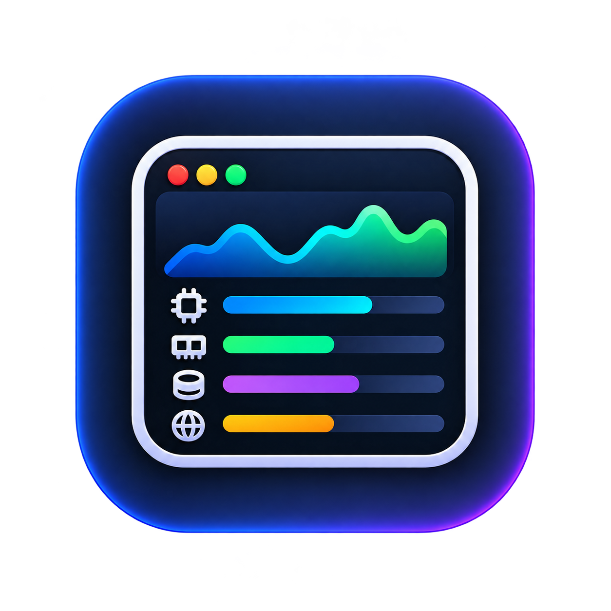
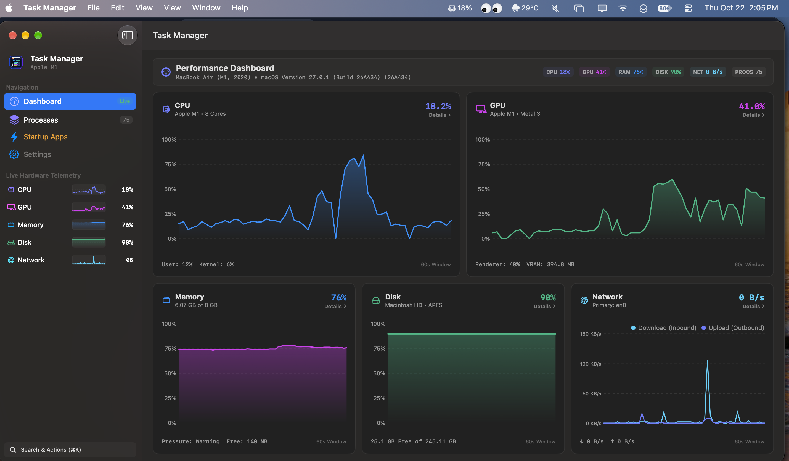
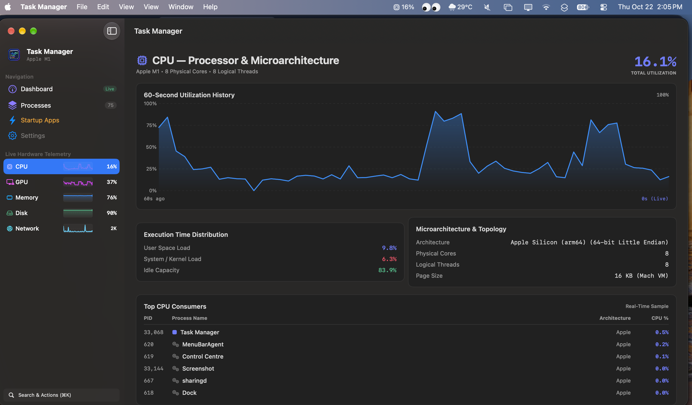
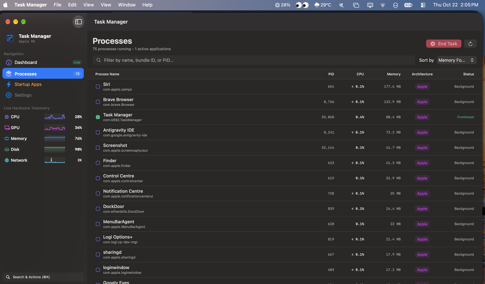
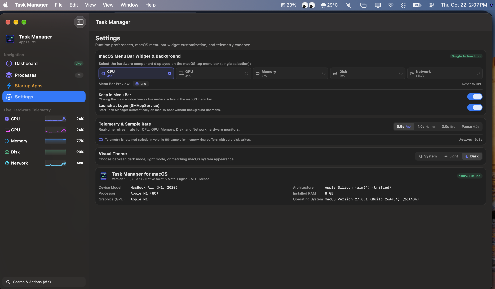

<div align="center">



# Task Manager for macOS
### The Native Hardware & Software Performance Monitor for macOS

[](https://developer.apple.com/macos/)
[](https://swift.org)
[-purple?style=for-the-badge)](https://developer.apple.com/documentation/apple-silicon)
[](https://developer.apple.com/metal/)
[-success?style=for-the-badge)](#-privacy--offline-guarantee)
[](#-privacy--offline-guarantee)
[](LICENSE)

<p align="center">
  <strong>A high-performance, featherlight, Windows Task Manager inspired software and hardware monitor for macOS. Live multi-engine GPU metrics, non-scrollable command-center dashboard, Mach CPU loads, memory pressure graphs, dedicated hardware deep-dive tabs, per-process telemetry with instant "End Task", live menu bar status, and startup app control.</strong>
</p>

[Overview](#-overview) •
[Screenshots](#-application-screenshots) •
[Key Features](#-key-features) •
[GPU Monitoring](#6--gpu-visualization--telemetry-apple-metal--iokit) •
[Installation & Build](#-installation--how-to-run) •
[Keyboard Shortcuts](#-keyboard-shortcuts) •
[Contributing](#-contributing)

</div>

---

## 📖 Overview

**Task Manager for macOS** brings the familiarity, precision, and power of the **Windows Task Manager** to the Mac ecosystem. It provides real-time, empirical hardware telemetry and granular software inspection without electron bloat, root daemons, or cloud analytics.

### Why Task Manager for macOS?
- **Zero Web Runtimes:** 100% native Swift, SwiftUI, AppKit, Metal, and Darwin Mach kernel APIs. No Electron, Node.js, Chromium, or web servers.
- **Featherlight Overhead:** Idles with `< 0.4%` CPU usage and `~25MB` memory footprint.
- **Non-Scrollable Single-Window Dashboard:** All 5 core performance graphs (CPU, GPU, Memory, Disk, Network) fit into one responsive viewport with zero vertical scrolling.
- **Dedicated Hardware Diagnostic Tabs:** Clicking any component in the sidebar opens an in-depth diagnostic tab exclusively detailing that component's microarchitecture, pipelines, and top processes.
- **Live Sidebar Sparklines:** Real-time mini-graphs rendered directly in the sidebar navigation in strict order: **CPU $\rightarrow$ GPU $\rightarrow$ Memory $\rightarrow$ Disk $\rightarrow$ Network**.
- **Real-Time 1-Second Mac Menu Bar Ticker:** The native macOS menu bar status extra streams live telemetry (CPU, GPU, Memory, Disk, or Network) every second in real time.
- **True GPU Visualization:** Real-time GPU load percentage, renderer utilization, tiler utilization, and allocated/in-use VRAM directly from Apple Silicon & discrete GPUs.
- **Memory-First Process Sorting:** Processes default-sorted by physical resident memory footprint for instant leak detection, with instant "End Task" process control.
- **100% In-Memory Ephemeral Telemetry:** Zero disk I/O writes for metrics; live 60-second rolling ring buffers prevent SSD wear. No SQLite metric rollups $>60$ seconds.
- **Single-Tab Non-Scrollable Settings:** Cleanly aligned, compact configuration options in one unified, non-scrollable panel fitting neatly within the window viewport.

---

## 📸 Application Screenshots

### 1. Performance Dashboard & Real-Time macOS Menu Bar
<p align="center">
  
</p>

*The non-scrollable Performance Dashboard delivers a unified command-center landing page featuring 60-second real-time charts for CPU, GPU, Memory, Disk, and Network, accompanied by live navigation sidebar sparklines and continuous macOS status bar telemetry.*

---

### 2. Dedicated Hardware Diagnostics (CPU Microarchitecture)
<p align="center">
  
</p>

*Dedicated hardware diagnostic views provide in-depth microarchitectural telemetry, core execution distributions, and top resource-consuming processes for each isolated hardware subsystem.*

---

### 3. Software & Process Management ("Processes" Tab)
<p align="center">
  
</p>

*The Processes view provides a real-time inventory of all active macOS applications and background tasks default-sorted by memory footprint with instant "End Task" termination.*

---

### 4. Non-Scrollable Settings & Menu Bar Widget Customization
<p align="center">
  
</p>

*The non-scrollable Settings panel offers single-selection macOS menu bar customization, configurable telemetry sampling cadences, visual themes, and complete offline hardware specifications.*

---

## ⚡ Key Features

### 1. ⚡ Non-Scrollable Performance Dashboard (Landing Page)
- **Single-Window Command Center:** Displays real-time 60-second interactive charts for all 5 hardware components in a clean 2-row grid fitting completely within the window viewport with zero vertical scrolling:
  - **Row 1:** CPU Card (50% width) and GPU Card (50% width, immediately succeeding CPU).
  - **Row 2:** Memory Card (33% width), Disk Card (33% width), and Network Card (33% width).
- **Thermal & Health Ticker:** Live thermal throttling status, system uptime counter, and active process count.
- **Direct Component Navigation:** Clicking any dashboard card or "Details →" button navigates straight to that component's dedicated in-depth view.

### 2. 🔍 Dedicated Hardware Diagnostic Tabs
Under `Live Hardware Telemetry` in the sidebar, selecting any component opens an isolated deep-dive inspection tab:
- **CPU:** 60s utilization chart, user/kernel/idle time split, core topology, clock speed, cache specs, and top CPU consuming processes.
- **GPU (Immediately after CPU):** 60s GPU utilization chart, renderer core %, tiler deferred rendering %, in-use VRAM, allocated VRAM, Metal 3 feature set, hardware ray tracing support, and mesh shading capabilities.
- **Memory:** 60s memory load chart, stacked color-coded Mach VM composition bar (Wired, Active, Compressed, Free), memory pressure status gauge, Mach page size, and top memory-consuming processes.
- **Disk:** 60s volume space history chart, all mounted APFS/external volume cards with capacity gauges, mount paths, and filesystem attributes.
- **Network:** 60s dual-line throughput chart (Download ↓ Cyan, Upload ↑ Indigo), primary interface status, and detailed interface adapter table with live transfer rates and session traffic.

### 3. 📊 Live Sidebar Sparklines (Real-Time Mini Graphs)
- Hardware-accelerated mini sparkline graphs stream live in the leftmost navigation sidebar in strict order:
  1. **CPU** — Live utilization % + Real-time sparkline graph
  2. **GPU** — Live GPU load % + Real-time sparkline graph (immediately after CPU!)
  3. **Memory** — Live RAM usage % + Real-time sparkline graph
  4. **Disk** — Live primary disk usage % + Real-time sparkline graph
  5. **Network** — Live throughput rate + Real-time sparkline graph
- Labels ("CPU", "GPU", "Memory", "Disk", "Network") have dedicated column widths ensuring zero text truncation.
- Uses right-aligned fixed-time coordinate mapping with center reference lines and active indicator dots.

### 4. 🍎 Real-Time 1-Second Mac Menu Bar Utility
- **Live Status Bar Label:** The macOS top menu bar item displays user-selected real-time hardware telemetry updated continuously every 1 second (e.g. `[CPU icon] 18%` or `[GPU icon] 41%`).
- **Popup Hardware Monitor:** Clicking the menu bar item opens a compact floating HUD displaying live CPU, GPU, Memory, Disk, Network, and Battery stats without opening the main window.
- **Common Mode RunLoop:** Scheduling on `RunLoop.main` in `.common` mode guarantees uninterrupted 1-second updates during user mouse tracking and scrolling.

### 5. 🚀 Software & Process Management ("Processes" Tab)
- Real-time inventory of all running applications and processes with inspectable memory, PID, and architecture (`Apple Silicon` / `Intel 64-bit`).
- **Memory-First Default Sort:** Automatically sorted by resident memory footprint descending to immediately surface memory-heavy applications.
- Live CPU % utilization per process calculated across Mach thread runtime differentials.
- Instant **"End Task"** action button and context menu with graceful (`NSRunningApplication.terminate`) and forced (`SIGKILL`) termination options.
- Instant search filter by application name, bundle identifier, or process PID.

### 6. 🎮 GPU Visualization & Telemetry (Apple Metal + IOKit)
- **Live 60-Second Utilization Graph:** Continuous GPU engine load time-series rendered via Swift Charts.
- **Multi-Engine Breakdown:** Overall Device Utilization %, Renderer Core Utilization %, and Tiler Pipeline Utilization %.
- **VRAM / Unified Memory Tracking:** Real-time allocated system memory and active in-use VRAM.
- **Metal Hardware Profile:** Dynamic device identification via Apple Metal (`MTLCopyAllDevices`).

### 7. ⚙️ Non-Scrollable Settings & Single-Selection Menu Bar Widget
- **100% Non-Scrollable Layout:** Entire settings panel fits comfortably inside the macOS window without vertical scrollbars.
- **Single-Selection Menu Bar Widget:** Select which hardware component (**CPU**, **GPU**, **Memory**, **Disk**, or **Network**) is visible on the macOS top status bar using single-selection radio chips, as only one icon and live telemetry metric can be displayed cleanly at a time.
- **Live Menu Bar Preview Ribbon:** Immediate simulated preview of the active menu bar status item with a one-click "Reset to CPU" option.
- **Telemetry & Sample Rate Control:** Custom segmented cadence pills (`0.5s Fast`, `1.0s Normal`, `3.0s Eco`, `Pause`) with active interval badge and explicit volatile in-memory ring buffer architecture (zero disk writes).
- **Appearance & Theme:** System, Light, and Dark mode selectors with instant interface adaptation.
- **Aligned 2-Column Hardware Specs:** Technical specifications (Device Model, Architecture, Processor, Installed RAM, Graphics GPU, OS Build) organized in a clean 2-column grid.
- **Desktop Widget Blueprint:** See [`Documentation/DesktopWidgetGuide.md`](Documentation/DesktopWidgetGuide.md) for full architectural patterns and Swift source code to add native macOS Sonoma/Sequoia Desktop Widgets.

---

## 🛠 Installation & How to Run

### Prerequisites
- macOS 13.0 (Ventura), macOS 14.0 (Sonoma), or macOS 15.0 (Sequoia)
- Xcode 15+ or Swift 5.9+ command-line tools

### Option 1: One-Click Build & Launch App Bundle (Recommended)

```bash
# Clone the repository
git clone https://github.com/K-692/Task-Manager4MacOS.git
cd Task-Manager4MacOS

# Compile release binary and assemble native dist/Task Manager.app bundle
./Scripts/build-app.sh

# Open Task Manager
open "dist/Task Manager.app"
```

### Option 2: Run via Swift Package Manager

```bash
swift run TaskManager
```

---

## ⌨️ Keyboard Shortcuts

| Shortcut | Action |
|:---|:---|
| <kbd>⌘</kbd> + <kbd>1</kbd> | Navigate to **Performance Dashboard** (Landing Page) |
| <kbd>⌘</kbd> + <kbd>2</kbd> | Navigate to **Processes** (Default: Memory Footprint) |
| <kbd>⌘</kbd> + <kbd>3</kbd> | Navigate to **Startup Apps** |
| <kbd>⌘</kbd> + <kbd>4</kbd> | Navigate to **Settings** |
| <kbd>⌘</kbd> + <kbd>5</kbd> | Navigate to **CPU Telemetry** Detail View |
| <kbd>⌘</kbd> + <kbd>6</kbd> | Navigate to **GPU Telemetry** Detail View |
| <kbd>⌘</kbd> + <kbd>7</kbd> | Navigate to **Memory Telemetry** Detail View |
| <kbd>⌘</kbd> + <kbd>8</kbd> | Navigate to **Disk Telemetry** Detail View |
| <kbd>⌘</kbd> + <kbd>9</kbd> | Navigate to **Network Telemetry** Detail View |
| <kbd>⌘</kbd> + <kbd>K</kbd> | Open **Command Palette** (Instant Search & Actions) |
| <kbd>⌘</kbd> + <kbd>R</kbd> | Force Immediate Hardware Telemetry Refresh |

---

## 🔒 Privacy & Offline Guarantee

- **100% Offline:** Zero network requests, zero telemetry beaconing, zero analytics SDKs.
- **Purely In-Memory Telemetry:** Telemetry history is strictly volatile (in-memory 60-sample ring buffers).
- **User Space Execution:** Zero root permissions or kernel extensions required.

---

## 🤝 Contributing

Contributions to **Task Manager for macOS** are welcome! Whether filing bug reports, suggesting new hardware sensors, or submitting pull requests:

1. **Fork** the repository on GitHub.
2. **Create a branch** for your feature (`git checkout -b feature/hardware-sensor`).
3. **Commit your changes** (`git commit -m 'Add support for Apple Neural Engine telemetry'`).
4. **Push to branch** (`git push origin feature/hardware-sensor`).
5. **Open a Pull Request** with architectural explanations.

---

## 📄 License

This project is licensed under the **MIT License** — see the [LICENSE](LICENSE) file for details.
